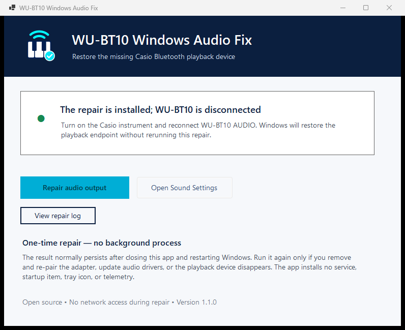

# WU-BT10 Windows Fix

A small, open-source Windows utility for Casio WU-BT10 Bluetooth Audio and
BLE-MIDI.

- Keeps the active **Headphones (WU-BT10 AUDIO)** endpoint at a safe 20% Windows
  volume.
- Detects and restores an Intel Bluetooth Audio device if it is already
  disabled.
- Bridges an advertising WU-BT10 BLE-MIDI peripheral to a standard Windows MIDI
  port named **WU-BT10 MIDI Bridge**.
- Detects BLE link loss and automatically rediscovers the device, rebuilds its
  GATT handles, and resubscribes to MIDI notifications.



> This is an independent community project. It is not affiliated with or
> endorsed by Casio. WU-BT10 and Casio are trademarks of their respective owner.

## Safety model

Older experimental builds tried to rebuild a missing Audio endpoint by toggling
the A2DP profile, disabling/re-enabling Intel audio offload, and restarting
Windows Audio Endpoint Builder. Those operations were unreliable and one failed
restore could leave Bluetooth Audio disabled.

Version 1.4.0 and later remove those code paths and native APIs entirely. The only
privileged operation left is **enable an Intel Bluetooth Audio device that
Windows already reports as disabled**, followed by verification. The app never:

- disables or restarts a device;
- toggles a Bluetooth profile;
- restarts an audio or Bluetooth service; or
- guesses a MIDI address from the Audio device's MAC address.

All normal diagnosis, Audio settings, volume, and MIDI functions run without
administrator access. The emergency enable action is hidden unless the exact
disabled-device condition is detected. It shows a detailed confirmation with
**No** selected by default before Windows is allowed to show UAC.

Windows has no supported public desktop API that reliably issues a Classic
Bluetooth A2DP client connection. The Audio button therefore opens Windows
Bluetooth settings for the user-controlled connection, then the app detects the
endpoint and applies 20% volume.

## Audio use

1. Plug WU-BT10 into a powered-on compatible Casio instrument.
2. Put the instrument in Bluetooth Audio pairing/connection mode.
3. Click **Connect Audio in Windows** and connect **WU-BT10 AUDIO** in Settings.
4. Return to the app. When the endpoint is active, it is set to 20%.
5. If the app specifically reports that Intel Bluetooth Audio is disabled,
   select **Restore Bluetooth Audio** and approve UAC once.

Audio configuration persists after the app closes. The app does not need to run
for listening.

## MIDI use

1. Install [Windows MIDI Services Runtime and Tools](https://microsoft.github.io/MIDI/get-latest/).
2. Make sure no phone, tablet, browser, or other BLE-MIDI bridge owns WU-BT10.
3. Put the instrument in its MIDI-advertising state.
4. Click **Connect WU-BT10 MIDI**.
5. Select **WU-BT10 MIDI Bridge** as the input in Piano Marvel or another MIDI
   application.

Keep this app open while using MIDI because it is the live BLE-to-MIDI bridge.
If the piano is restarted or the BLE link drops, the app keeps the virtual port
and reconnects automatically when WU-BT10 advertises again.

The initial connection allows up to 60 seconds. This is intentional: Microsoft
documents that an unpaired `BluetoothLEDevice` object does not necessarily
connect immediately and that uncached GATT discovery has variable timing.
Every failed attempt releases all app-owned GATT objects and waits for another
live BLE-MIDI advertisement before retrying.

## Requirements

- Windows 10 version 1809 or later, or Windows 11
- x64 or ARM64
- .NET is included in published single-file builds
- Windows MIDI Services Runtime and Tools for the integrated MIDI port

Windows MIDI Services does not yet ship a released BLE-MIDI transport, so this
app supplies the BLE bridge and uses Windows MIDI Services only for its virtual
loopback endpoint.

## Privacy

- No telemetry, account, updater, service, startup entry, or tray process.
- BLE and repair operations are local.
- Network access occurs only when the user clicks an external download or
  optional support link.
- Structured connection diagnostics are stored in
  `%LOCALAPPDATA%\WU-BT10-Fix\diagnostics`. They rotate at 2 MiB and retain at
  most 20 files. MIDI payload bytes are not recorded.
- Emergency-repair log: `%LOCALAPPDATA%\WU-BT10-Fix\repair.log`.

## Build and test

Install the .NET 9 SDK, then run:

```powershell
dotnet restore WUBT10Fix.slnx
dotnet build WUBT10Fix.slnx -c Release --no-restore
dotnet test WUBT10Fix.slnx -c Release --no-build
dotnet publish src/WUBT10Fix/WUBT10Fix.csproj -c Release -r win-x64 --self-contained true
```

Use `win-arm64` for Windows on ARM. To include a support button, pass an HTTPS
`SupportUrl` MSBuild property. See [docs/SIGNING.md](docs/SIGNING.md) for the
production Authenticode release process.

## License

[MIT](LICENSE)
